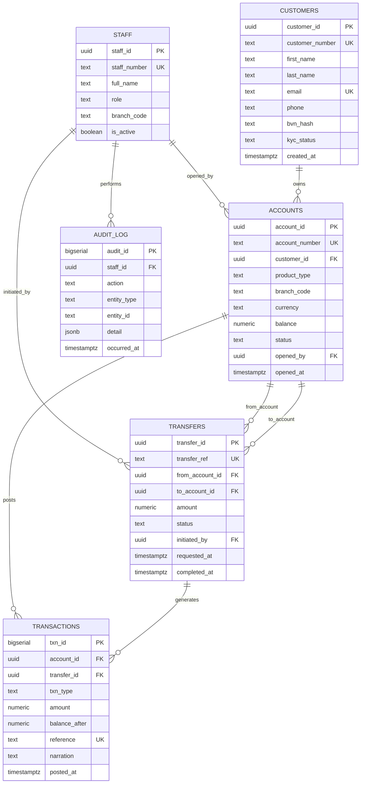

# Lagos Community Bank — Entity-Relationship Model

**Document:** Hart_Harney_301932250_ER_Diagram  
**Portfolio:** 1 — Database Design

## Design intent

I modelled the core retail-banking surface that tellers touch every day: who the
customer is, which accounts they hold, every ledger movement, and the transfer
request that ties a debit leg to a credit leg. Staff and audit_log sit beside
the money tables so branch actions remain attributable without polluting the
ledger itself.

## Mermaid ER diagram

## Cardinality notes

- One customer may hold many accounts (savings, current, fixed deposit).
- One account posts many ledger transactions; each transaction belongs to exactly one account.
- A transfer references exactly two accounts and, on success, produces two ledger rows
  (debit on source, credit on destination) linked by `transfer_id`.
- Staff open accounts, initiate transfers, and leave audit entries.

## Export

Render the Mermaid block above to PNG as
`screenshots/Hart_Harney_301932250_ER_Diagram.png` (see generation script in
`docs/` if needed). The same diagram is also stored under `images/` at the
portfolio root for the final summary.
