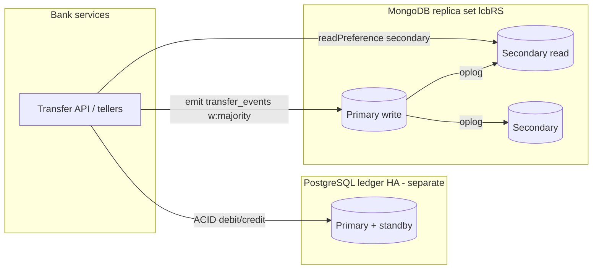

# Portfolio 5 — Architecture & HA Notes

**Document:** Hart_Harney_301932250_Architecture

## Topology

Rendered PNG: `screenshots/Hart_Harney_301932250_Architecture.png`

## What I demonstrated live

1. Three-member replica set `lcbRS` on `127.0.0.1:27017-27019`.
2. Primary write of `transfer_events`, then secondary read on `:27018`.
3. Controlled `rs.stepDown`: primary moved from `:27017` to `:27018`; majority
   write resumed (`EVT-RS-AFTER-FAILOVER`).

Docker Compose (`docker/docker-compose.yml`) describes the same three-node
layout using host networking. The captured evidence used the host mongod
processes via `scripts/05_run_host_replica.sh` after Docker bridge networking in
this environment could not complete inter-container quorum checks.

## Design notes for the bank workload

- **Majority write concern (`w: "majority"`):** a posted event is durable on a
  majority of voting members before the API returns success for the event stream.
  That matches “tell the ops timeline only after the cluster agrees”.
- **Replication lag:** secondaries can briefly trail the primary. Customer-facing
  balance reads stay on PostgreSQL; Mongo secondary reads are for event timelines
  and analytics that tolerate seconds of lag.
- **Sharding:** not required at current event volumes. Shard by `transfer_ref` or
  hashed `from_account` only if event ingest outgrows a single primary’s write
  capacity. Sharding adds operational cost without helping ledger correctness.
- **PostgreSQL needs its own HA:** a Mongo replica set does not protect account
  balances. The ledger would use streaming replication / Patroni (or cloud HA)
  separately. Mongo replicates *events about* transfers; Postgres remains money.
